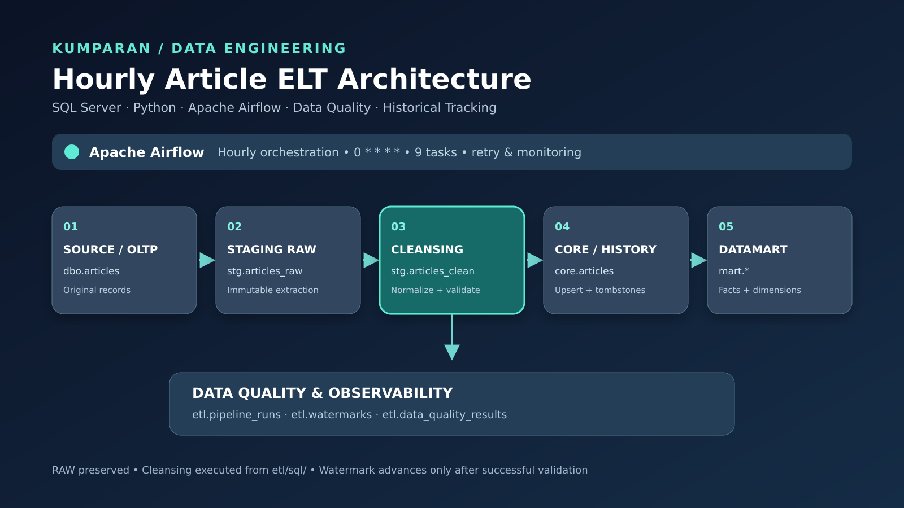
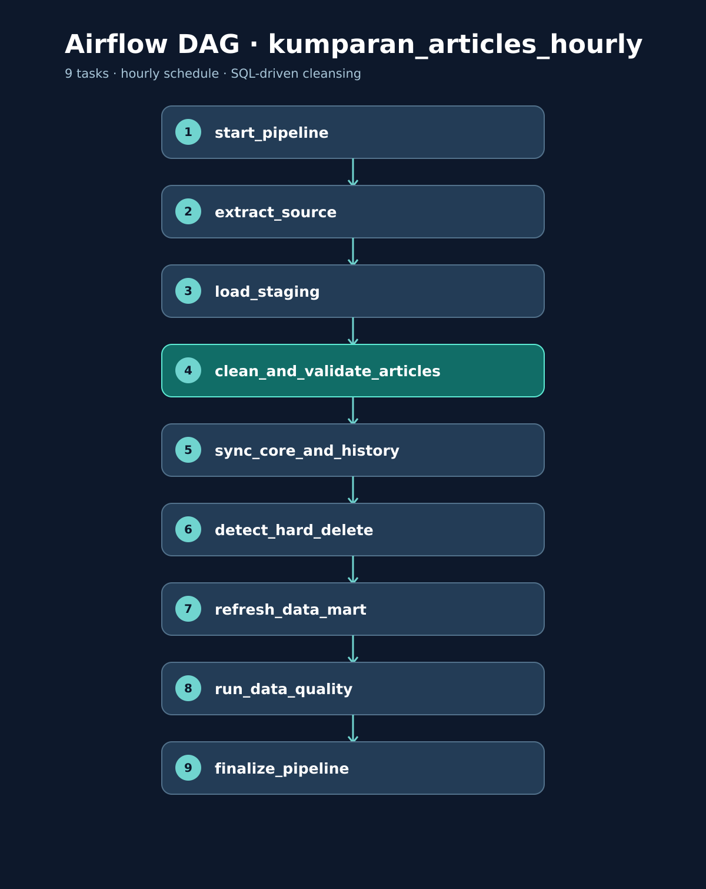

# 🚀 Data Pipeline Project: Kumparan Articles ELT

**Data Engineer Assessment | SQL Server · Python · Apache Airflow · Docker**

> Project ini menggunakan artikel **sintetis (dummy)** untuk simulasi Data Engineering, bukan data atau infrastruktur internal kumparan.

---

## 📌 Overview

Project ini membangun pipeline **ELT (Extract, Load, Transform)** untuk memindahkan artikel dari database operasional ke Data Warehouse dan Datamart. Pipeline berjalan setiap jam dan menangani initial load, incremental update, data cleansing, riwayat perubahan, soft delete, hard delete, serta data quality monitoring.

Teknologi utama: **Microsoft SQL Server**, **Python 3.11 + pymssql**, **Apache Airflow 2.10.5**, **Docker Compose**, dan **PostgreSQL 16** (khusus metadata Airflow).

## 📂 Struktur Project (sesuai paket ini)

```text
task-kumparan/
├── dags/kumparan_articles_hourly.py
├── etl/sql/cleansing_articles.sql
├── script_sql/
│   ├── 01_database_setup.sql
│   ├── 02_insert_data_articles.sql
│   ├── 04_etl_validation.sql
│   └── 05_seed_dirty_articles.sql
├── archive/manual_dwh_bootstrap_NOT_FOR_AIRFLOW.sql
├── docs/README.md
├── docs/ETL_FLOW.md
├── docs/CLEANSING.md
├── docs/RUNNING_GUIDE.md
├── docs/PRESENTATION_GUIDE.md
├── images/
├── Dockerfile
├── docker-compose.yml
└── .env.example
```

> File `archive/manual_dwh_bootstrap_NOT_FOR_AIRFLOW.sql` adalah contoh bootstrap manual lama; **jangan dijalankan bersamaan dengan DAG**. `.env` disimpan lokal dan tidak termasuk ZIP distribusi.

---

## 🔄 Arsitektur Data Pipeline





➡️ [Dokumentasi flow lengkap](docs/ETL_FLOW.md)

```text
Kumparan_Source.dbo.articles
             │
             ▼
    Extract / Incremental
             │
             ▼
Kumparan_DWH.stg.articles_raw     (raw, tidak diubah)
             │
             ▼
    SQL Cleansing & Validation
             │
             ▼
Kumparan_DWH.stg.articles_clean   (hasil per run_id)
             │
             ▼
Kumparan_DWH.core.articles
             ├── core.article_change_history
             │
             ▼
Kumparan_DWH.mart
             ├── dim_date
             ├── dim_author
             ├── fact_article_publication
             ├── agg_article_daily
             └── agg_author_daily

Apache Airflow  → schedule, orkestrasi, log
Kumparan_DWH.etl → watermark, run, data quality
PostgreSQL      → metadata Airflow saja
```

| Layer | Peran |
|---|---|
| Source (`dbo`) | Data artikel operasional asli |
| Staging raw (`stg.articles_raw`) | Hasil ekstraksi per run tanpa cleansing |
| Staging clean (`stg.articles_clean`) | Artikel hasil normalisasi untuk diproses ke core |
| Core (`core`) | Artikel terkini dan histori perubahan |
| Datamart (`mart`) | Dimensi, fact publikasi, dan agregasi |
| Monitoring (`etl`) | Run status, watermark, dan hasil data quality |

---

## 📊 Data Source

Sumber utama: **`Kumparan_Source.dbo.articles`** dengan atribut `id`, `title`, `content`, `author_id`, `published_at`, `created_at`, `updated_at`, dan `deleted_at`. Dataset awal assessment menggunakan **12.000 artikel sintetis** yang pernah dilaporkan dalam pengujian.

| Perubahan source | Perlakuan |
|---|---|
| INSERT | Artikel baru disinkronkan ke core |
| UPDATE | Data core diperbarui dan perubahan dicatat di history |
| Soft delete | `deleted_at` disimpan; artikel dikecualikan dari fact aktif |
| Hard delete | Artikel yang hilang dari source ditandai di core, bukan langsung dihapus |

---

## 🧹 Data Cleansing & Validation

Cleansing dilakukan dengan **SQL Server query** yang dipanggil dari task Python Airflow `clean_and_validate_articles`. Source dan raw staging tidak dimodifikasi; hasil disimpan ke **`stg.articles_clean`** per `run_id`.

| Pemeriksaan / transformasi | Aturan |
|---|---|
| Judul artikel | Ganti CR/LF/TAB dan non-breaking space menjadi spasi; trim tepi |
| Konten artikel | Trim tepi; paragraf dan line break dipertahankan |
| Judul kosong | Validasi kritis; run dihentikan sebelum sinkronisasi core |
| `updated_at < created_at` | Validasi kritis |
| Jumlah raw vs clean | Harus konsisten untuk run yang diproses |
| Konten kosong | Warning, bukan pengisian konten buatan |
| Tanggal publikasi/hapus anomali | Warning yang dicatat untuk pemeriksaan |

Hasil validasi cleansing dan data quality dicatat di `etl.data_quality_results`. Tidak ada lowercase massal, penghapusan stopword, atau perubahan isi berita secara semantik.

**Script:** [`etl/sql/cleansing_articles.sql`](etl/sql/cleansing_articles.sql) · **DDL:** [`script_sql/01_database_setup.sql`](script_sql/01_database_setup.sql) · **Verifikasi:** [`script_sql/04_etl_validation.sql`](script_sql/04_etl_validation.sql)

➡️ [Detail aturan dan keterbatasan cleansing](docs/CLEANSING.md)

---

## ⭐ Data Warehouse & Star Schema

Model analitik menggunakan dua dimensi utama (`mart.dim_date` dan `mart.dim_author`) yang mendukung `mart.fact_article_publication`. Agregasi disediakan melalui `mart.agg_article_daily` dan `mart.agg_author_daily`.

```text
  mart.dim_date          mart.dim_author
         \                  /
          \                /
       mart.fact_article_publication
                    │
           ┌────────┴────────┐
           ▼                 ▼
  mart.agg_article_daily   mart.agg_author_daily
```

Fact publikasi hanya mencakup artikel dengan `published_at` terisi, `deleted_at IS NULL`, dan tidak ditandai hard deleted. Jumlah fact karena itu tidak harus sama dengan jumlah source.

---

## ⚙️ Apache Airflow DAG

- **DAG ID:** `kumparan_articles_hourly`
- **Schedule:** `0 * * * *` (setiap jam)
- **Executor:** `LocalExecutor` pada Docker Compose

```text
start_pipeline
      ↓
extract_source
      ↓
load_staging
      ↓
clean_and_validate_articles
      ↓
sync_core_and_history
      ↓
detect_hard_delete
      ↓
refresh_data_mart
      ↓
run_data_quality
      ↓
finalize_pipeline
```

Task cleansing dieksekusi **sebelum** upsert ke core. Watermark diperbarui setelah proses pipeline berhasil.

---

## ⏱ Initial Load & Incremental Processing

- **Initial load:** jika watermark belum tersedia, ekstraksi dimulai dari `2016-01-01`, dengan batch 1.000 artikel yang diurutkan menurut `(updated_at, id)`.
- **Incremental load:** menggunakan jendela `[last_watermark - 5 minutes, source_now)` untuk mengurangi risiko perubahan terlambat terambil.
- **History:** revisi artikel tercatat di `core.article_change_history`.
- **Delete:** soft delete dan hard delete dipertahankan sebagai status, bukan menghapus histori.

Bootstrap manual (`archive/manual_dwh_bootstrap_NOT_FOR_AIRFLOW.sql`) adalah jalur persiapan terpisah dan **bukan** bukti initial load melalui Airflow.

---

## 📈 Data Quality & Monitoring

| Media | Yang dimonitor |
|---|---|
| Airflow Dashboard | Status DAG/task, log, durasi, retry |
| `etl.pipeline_runs` | Hasil dan metrik setiap run |
| `etl.watermarks` | Posisi incremental terakhir |
| `etl.data_quality_results` | Pemeriksaan cleansing dan kualitas mart |
| `core.article_change_history` | Histori perubahan artikel |

Untuk inspeksi SQL, gunakan `script_sql/04_etl_validation.sql`, `08_presentation_validation.sql`, dan `10_verify_cleansing.sql`.

---

## 🧪 Testing & Validation

Skenario yang perlu diuji: **INSERT, UPDATE, soft delete, restore, hard delete, cleansing title, konten kosong, timestamp invalid, idempotensi retry**, dan rekonsiliasi row count raw–clean–core–mart.

Pada bukti pengujian **6 November 2026**, terdapat tiga run `SUCCESS` dengan extracted count **12.000, 0, 0**; angka inserted run pertama **0** konsisten dengan bootstrap manual sebelumnya. Hasil tersebut **bukan verifikasi end-to-end untuk cleansing versi baru**. Pengujian Airflow + SQL Server langsung tetap diperlukan.

---

## 📚 Dokumentasi

- 📘 [Panduan menjalankan project](docs/RUNNING_GUIDE.md) — konfigurasi, SQL Server, Docker, Airflow, dan troubleshooting.
- 🧹 [Data cleansing](docs/CLEANSING.md) — aturan, langkah aktivasi, dan keterbatasan.
- 🧪 [Presentation guide](docs/PRESENTATION_GUIDE.md) — urutan demo assessment.
- 🗃️ [AI dan data historis](docs/PENGGUNAAN_AI_DAN_PENGELOLAAN_DATA_HISTORIS.md) — disclosure dan penggunaan data dummy.

**Catatan keamanan:** jangan unggah `.env` berisi password, jangan menjalankan `docker compose down -v` jika metadata Airflow ingin dipertahankan, dan lakukan pengujian mutasi pada data dummy terisolasi.

## 🧩 Pemisahan query SQL dan orkestrasi

SQL cleansing berada di [`etl/sql/cleansing_articles.sql`](etl/sql/cleansing_articles.sql), dibaca oleh task Python `clean_and_validate_articles`. Query dieksekusi otomatis oleh Airflow pada SQL Server, bukan dijalankan manual setiap jam. `script_sql/` menyimpan DDL, seed, dan query pemeriksaan.


## Catatan kesesuaian implementasi (8 November 2026)

Dokumentasi alur utama yang telah diverifikasi terhadap DAG berada di [ETL_FLOW.md](docs/ETL_FLOW.md). Data invalid dialihkan ke `stg.articles_rejected`; tidak otomatis membuat DAG gagal. Pada saat ini belum ada bukti eksekusi terbaru dalam paket ZIP yang memvalidasi semua skenario. Jangan menganggap contoh output historis sebagai hasil uji versi terkini.
