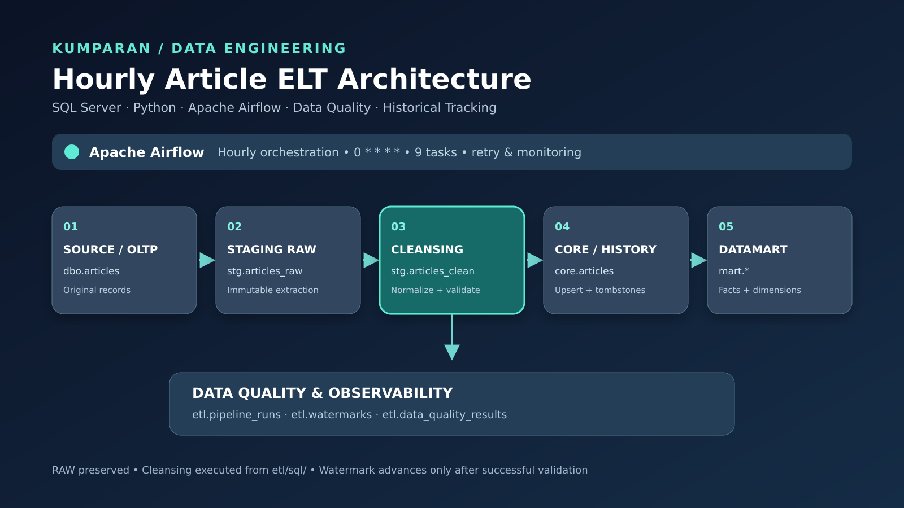
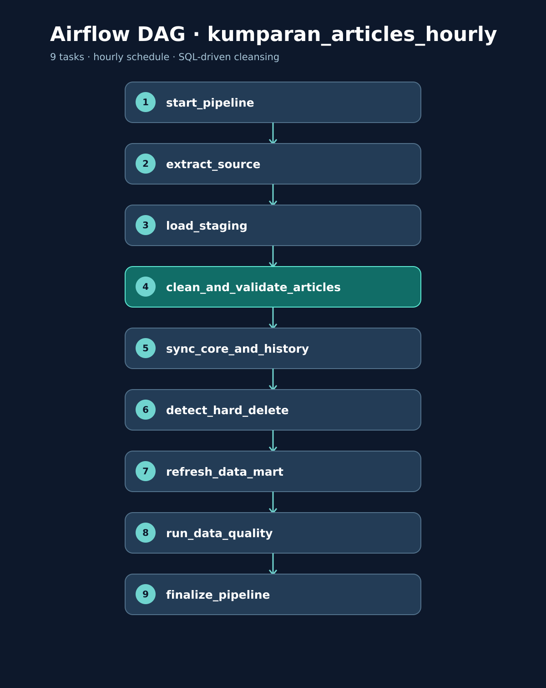

# Alur Implementasi ELT — Kumparan Articles

> Dokumentasi ini disesuaikan dengan `dags/kumparan_articles_hourly.py` dan `etl/sql/cleansing_articles.sql` dalam paket project. Ini menjelaskan **implementasi dalam kode**, bukan bukti bahwa seluruh skenario telah berhasil dijalankan di SQL Server.



## 1. Tujuan dan arsitektur

Pipeline **ELT** memindahkan artikel sintetis dari `Kumparan_Source.dbo.articles` ke `Kumparan_DWH` melalui staging RAW, cleansing SQL, Core, dan Data Mart. Airflow 2.10.5 mengorkestrasi sembilan task menggunakan Python/pymssql; PostgreSQL 16 hanya menyimpan metadata Airflow, bukan data artikel. Database Source dan DWH harus berada pada **instance SQL Server yang sama** untuk query lintas database.

```text
Kumparan_Source.dbo.articles
  │ extract_source: incremental + historical recovery / manual backfill
  ▼
Kumparan_DWH.stg.articles_raw (snapshot per run_id; data asli dipertahankan)
  │ clean_and_validate_articles → etl/sql/cleansing_articles.sql
  ├───────────────► stg.articles_rejected (invalid + reject_reason)
  ▼
stg.articles_clean (valid + hasil normalisasi)
  │ sync_core_and_history
  ▼
core.articles ─────────► core.article_change_history
  │ detect_hard_delete (hanya mode incremental)
  ▼
mart.dim_date / mart.dim_author / mart.fact_article_publication
  │
  ├─► mart.agg_article_daily
  └─► mart.agg_author_daily

Monitoring: etl.pipeline_runs + etl.data_quality_results
Checkpoint: etl.watermarks + etl.recovery_state
```

## 2. Konfigurasi dan jadwal

- DAG: `kumparan_articles_hourly`, jadwal `0 * * * *` (setiap jam), `catchup=False`, `max_active_runs=1`.
- Task retry maksimal **2 kali** dengan jeda **5 menit**.
- Ekstraksi menggunakan batch **1.000 artikel**, overlap watermark **5 menit**, dan recovery scan default **1.000 ID per run** (`RECOVERY_SCAN_SIZE`).
- `MSSQL_HOST`, `MSSQL_PORT`, `MSSQL_USER`, `MSSQL_PASSWORD`, `MSSQL_SOURCE_DB`, `MSSQL_DWH_DB` diambil dari environment; direktori SQL runtime default `/opt/airflow/etl/sql` atau `KUMPARAN_SQL_DIR`.
- Docker Compose menyediakan `airflow-db`, `airflow-init`, `airflow-webserver` (`8080:8080`), dan `airflow-scheduler`.

## 3. Urutan sembilan task Airflow

| Urutan | Task | Implementasi nyata | Output / pemeriksaan |
|---|---|---|---|
| 01 | `start_pipeline` | Validasi seluruh tabel DWH, buat `run_id`, ambil watermark, recovery cursor, dan cutoff UTC; mendukung `incremental` atau `backfill` manual | `etl.pipeline_runs` berstatus RUNNING dan konteks XCom |
| 02 | `extract_source` | Ambil perubahan `updated_at` dalam jendela watermark; scan historis bergilir; atau ambil rentang ID saat backfill | `stg.articles_raw` untuk `run_id` berjalan, `extracted_count` |
| 03 | `load_staging` | Periksa jumlah RAW terhadap hasil extract dan keunikan ID dalam run | Gagal jika count/keunikan tidak cocok |
| 04 | `clean_and_validate_articles` | Jalankan SQL runtime, klasifikasi valid/invalid, simpan ke CLEAN/REJECTED, catat audit | `stg.articles_clean`, `stg.articles_rejected`, `etl.data_quality_results` |
| 05 | `sync_core_and_history` | Sinkronisasi artikel valid ke Core dan catat perubahan | `core.articles`, `core.article_change_history` |
| 06 | `detect_hard_delete` | Bandingkan Core aktif dengan ID Source, tandai yang hilang (tanpa menghapus fisik) | `is_hard_deleted`, history; dilewati pada backfill |
| 07 | `refresh_data_mart` | Isi dimensi, bangun ulang fact dan dua agregasi dalam transaksi SQL | `mart.*` |
| 08 | `run_data_quality` | Periksa kesesuaian fact, agregasi, dimensi, RAW=CLEAN+REJECTED, sinkronisasi Core, orphan aktif | Audit DQ; error untuk mismatch kritis |
| 09 | `finalize_pipeline` | Jika sukses, set status SUCCESS; untuk incremental perbarui watermark dan recovery cursor | `etl.pipeline_runs`, `etl.watermarks`, `etl.recovery_state` |

## 4. Initial load, incremental, recovery, dan backfill

**Initial load:** Jika watermark belum ada, batas bawah adalah 1900-01-01; artikel historis yang memenuhi cutoff diambil dari Source. Jangan menyamakan hasil bootstrap SQL manual dengan keberhasilan initial load Airflow.

**Incremental:** Query memakai `updated_at >= (watermark - 5 menit)` dan `updated_at < cutoff`, dengan pagination berdasarkan `(updated_at,id)`. Cutoff UTC ditetapkan di `start_pipeline`. Watermark baru disimpan hanya setelah `run_data_quality` berhasil.

**Recovery scan:** Setiap run incremental memeriksa sejumlah ID Source secara bergilir, membandingkan keberadaan ID dan `updated_at` terhadap Core. Cursor berada di `etl.recovery_state` dan baru maju setelah sukses. Ini bukan CDC penuh: perubahan konten tanpa perubahan `updated_at` bisa tidak terdeteksi.

**Backfill manual:** Trigger DAG dengan konfigurasi contoh:

```json
{"mode":"backfill","article_id_from":12001,"article_id_to":12200}
```

Rentang maksimal 100.000 ID (selisih batas < 100.000). Mode backfill tidak melakukan pemeriksaan hard delete global dan tidak memajukan watermark/recovery cursor.

## 5. Cleansing dan rejected records

SQL di `etl/sql/cleansing_articles.sql` dieksekusi otomatis oleh task ke-4; **jangan menjalankan SQL runtime ini secara langsung di DBeaver** karena memakai parameter `%s` dari Python.

| Pemeriksaan | Implementasi | Hasil |
|---|---|---|
| Judul | Ganti NBSP, tab, CR, LF menjadi spasi; trim tepi | Jika kosong setelah normalisasi → REJECTED (`EMPTY_TITLE`) |
| Konten | Trim spasi tepi; konten internal tidak dinormalisasi menyeluruh | Jika kosong setelah trim → REJECTED (`EMPTY_CONTENT`) |
| Timestamp | `updated_at < created_at` | REJECTED (`INVALID_UPDATED_AT`) |
| Draft | `published_at IS NULL` | Tetap CLEAN jika aturan lainnya valid; tidak masuk fact publikasi |
| Soft delete | `deleted_at IS NOT NULL` | Tetap CLEAN jika aturan lainnya valid; tidak masuk fact publikasi |

Alasan reject dipilih menurut prioritas **judul → konten → timestamp**, sehingga satu artikel menyimpan satu `reject_reason`. Hasil cleansing tidak mengubah Source atau RAW. `stg.articles_clean` dan `stg.articles_rejected` dikelompokkan berdasarkan `run_id`.

**Penting:** Artikel invalid **tidak otomatis menggagalkan seluruh pipeline**. Kode mencatat jumlah reject sebagai pemeriksaan non-kritis (`cleansing_rejected_count`), sedangkan kesetaraan `RAW = CLEAN + REJECTED` adalah pemeriksaan kritis. Ketidakcocokan partisi atau pemeriksaan DQ kritis menyebabkan task gagal. Data yang ditolak tidak di-upsert ke Core.

Untuk seed 200 artikel, secara desain terdapat 60 kasus reject (20 judul kosong, 20 konten kosong, 20 timestamp invalid) dan 140 kandidat CLEAN. **Angka ini merupakan ekspektasi berdasarkan skenario seed, bukan hasil uji runtime.**

## 6. Core, perubahan, dan mart

- `core.articles` menyimpan kondisi terkini artikel valid. `core.article_change_history` menyimpan riwayat perubahan yang dicatat pipeline.
- Soft delete ditentukan oleh `deleted_at`; hard delete ditentukan ketika ID Core tidak lagi ditemukan di Source dan ditandai `is_hard_deleted=1` (bukan `DELETE` fisik).
- `mart.fact_article_publication` hanya memuat Core dengan `published_at IS NOT NULL`, `deleted_at IS NULL`, `is_hard_deleted=0`.
- `mart.dim_date` dan `mart.dim_author` diperluas berdasarkan Core; fact dan agregasi di-refresh penuh pada setiap run. Refresh fact/agregasi memakai `DELETE` + `INSERT` **dalam transaksi**, sehingga bukan append incremental untuk mart.

## 7. Monitoring dan Data Quality

`etl.pipeline_runs` menyimpan status RUNNING/SUCCESS/FAILED dan metrik. `etl.data_quality_results` mencatat pemeriksaan cleansing dan mart. `etl.watermarks` mencatat checkpoint incremental; `etl.recovery_state` mencatat posisi scan historis. Periksa dengan `script_sql/04_etl_validation.sql` setelah run. Pemeriksaan CLEAN harus dibandingkan dengan RAW dan REJECTED **pada run_id yang sama**, bukan mengharuskan RAW=CLEAN.

## 8. Batasan dan pengujian yang belum dibuktikan

- Pemeriksaan hard delete dan ekstraksi Source tidak memakai satu snapshot konsisten; perubahan paralel bisa menimbulkan hasil sementara yang tidak konsisten.
- Recovery membandingkan ID dan `updated_at`, bukan hash konten/CDC SQL Server.
- Retry dan kegagalan setelah commit Core perlu diuji untuk idempotensi history dan rekonsiliasi ulang.
- Kode refresh mart cocok untuk skala assessment, bukan strategi optimal untuk dataset besar.
- Kualitas DQ yang dicatat perlu ditafsirkan berdasarkan `details` (CRITICAL/WARNING), bukan hanya `passed=0`.
- Belum ada bukti pengujian langsung dari ZIP ini bahwa seluruh skenario dirty seed, recovery, dan backfill sudah lulus.

## 9. File dan langkah operasional

1. `script_sql/01_database_setup.sql` — database, schema, tabel, index, CLEAN, REJECTED, dan recovery state.
2. `script_sql/02_insert_data_articles.sql` — seed historis sintetis (opsional, testing).
3. `script_sql/05_seed_dirty_articles.sql` — 200 data uji kualitas (opsional, testing).
4. `etl/sql/cleansing_articles.sql` — SQL runtime yang dipanggil DAG.
5. `script_sql/04_etl_validation.sql` — validasi read-only setelah run.
6. `docs/RUNNING_GUIDE.md` — cara konfigurasi, menjalankan, dan troubleshooting.


